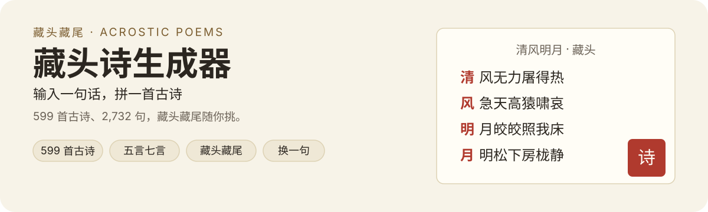
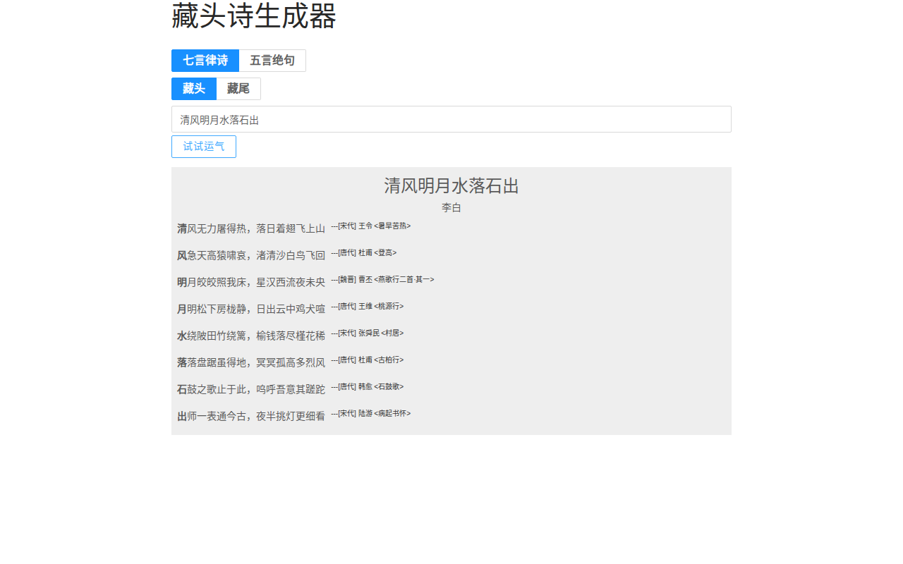

<p align="right"><a href="README.md">中文</a></p>

<p align="center">
  
</p>

<p align="center">
  <a href="https://xiaosang.cc/head-tail-poem-generator/">▶ Try Online</a>
  ·
  <a href="https://github.com/holynova/head_tail_poem_generator">GitHub Repository</a>
</p>

Head & Tail Poem Generator: type a phrase and it assembles an acrostic poem from real lines of classical Chinese poetry. Enter 清风明月水落石出 and the first line starts with 清, the second with 风, and so on — each line cites its source (dynasty, author, title), and any line can be swapped individually. The library holds 599 poems, from pre-Qin to Qing.

## Screenshots

<p align="center">
  
</p>

## Features

- **Head or tail** (藏头 / 藏尾): each input character becomes the first (head) or last (tail) character of one line.
- **5 or 7 characters** (五言 / 七言): five-character quatrains or seven-character regulated verse; lines are matched by length.
- **Cited sources**: every line shows its dynasty, author, and title, e.g. [唐代] 杜甫《登高》.
- **Swap one line**: tap 「换一个」 ("Swap one") to replace any single line with another candidate; the button tells you how many alternatives exist for that character.
- **Honest misses**: if no line exists for a character, it says so — 「翻遍字典没找到，你快过来自己编」 ("Couldn't find it in the whole dictionary, come write it yourself").

## Corpus

| | Count |
|---|------|
| Poems included | 599 (Tang 322, Song 119, plus pre-Qin to Qing) |
| Indexed lines | 2,732 |
| Head dictionary coverage | 923 characters |
| Tail dictionary coverage | 974 characters |

Raw Tang/Song poetry JSON and processing notes are kept under `pre_process/`; the app uses the three prebuilt dictionaries in `src/assets/` (`headWordDict.js`, `tailWordDict.js`, `poemDict.js`).

## Run Locally

```bash
npm install
npm start       # Create React App dev server (ejected config)
npm run build   # production build to build/
```

A prebuilt `build/` is committed and can be served statically.

## Tech

- React 16 + Ant Design 4, Create React App (ejected, webpack config in `config/`).
- Generation logic in `src/components/PoemGen.jsx`: look up the character in the dictionary → filter by line length → pick a line at random; swapping re-picks until the line differs from the previous one.
- Pure frontend, no backend; the poem dictionaries are bundled into JS at build time.

```
src/components/PoemGen.jsx   Main generator component: input / 5- or 7-char / head-or-tail / swap line
src/assets/headWordDict.js   Head dictionary: 923 characters → 2,732 lines
src/assets/tailWordDict.js   Tail dictionary: 974 characters → 2,732 lines
src/assets/poemDict.js       Poem dictionary: 599 poems (dynasty / author / title / full text)
pre_process/                 Raw Tang/Song poetry JSON and processing notes
build/                       Committed build output
```
