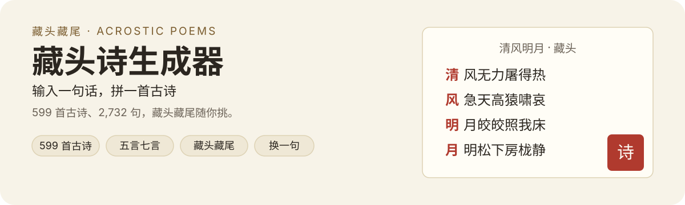
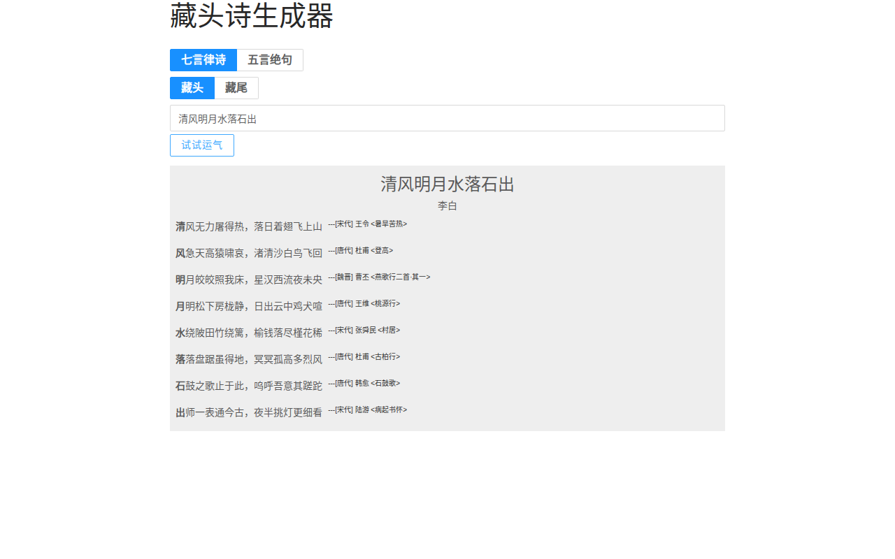

<p align="right"><a href="README.en.md">English</a></p>

<p align="center">
  
</p>

<p align="center">
  <a href="https://xiaosang.cc/head-tail-poem-generator/">▶ 在线体验</a>
  ·
  <a href="https://github.com/holynova/head_tail_poem_generator">GitHub 仓库</a>
</p>

藏头诗生成器：输入一句话，它就用古诗里的现成诗句拼一首藏头（或藏尾）诗。输入「清风明月水落石出」，第一句取以「清」开头的诗句，第二句取以「风」开头的……每句都标注出处（朝代、作者、篇名），不满意某一句可以单独换一句。诗句库来自 599 首古诗，先秦到清代都有。

## 截图

<p align="center">
  
</p>

## 功能

- **藏头 / 藏尾**：输入的每个字依次成为每句诗的第一个字（藏头）或最后一个字（藏尾）。
- **五言 / 七言**：五言绝句或七言律诗两种句长，按字数从诗句库里匹配。
- **逐句出处**：每句标注朝代、作者与篇名，例如「---[唐代] 杜甫 <登高>」。
- **单独换一句**：某句不满意，点「换一个」只换这一句，还会告诉你这个字共有几首可选。
- **查不到就直说**：某个字在字典里没有对应诗句时，显示「翻遍字典没找到，你快过来自己编」。

## 诗句库

| | 数量 |
|---|------|
| 收录古诗 | 599 首（唐代 322、宋代 119，其余先秦至清代） |
| 索引诗句 | 2,732 句 |
| 藏头字典覆盖字 | 923 字 |
| 藏尾字典覆盖字 | 974 字 |

`pre_process/` 下保留了原始唐宋诗词 JSON 与处理说明；应用实际使用的是 `src/assets/` 下预处理好的三份字典（`headWordDict.js`、`tailWordDict.js`、`poemDict.js`）。

## 本地运行

```bash
npm install
npm start       # Create React App 开发服务器（ejected 配置）
npm run build   # 生产构建到 build/
```

仓库内已提交一份 `build/` 构建产物，可直接用静态服务器打开。

## 技术

- React 16 + Ant Design 4，Create React App（已 eject，webpack 配置在 `config/`）。
- 生成逻辑在 `src/components/PoemGen.jsx`：按字查字典 → 按句长过滤 → 随机取一句；换句时随机重取直到与上一句不同。
- 纯前端，无后端；诗句字典在构建时打包进 JS。

```
src/components/PoemGen.jsx   生成器主组件：输入 / 五七言 / 藏头藏尾 / 换句
src/assets/headWordDict.js   藏头字典：923 字 → 2,732 句
src/assets/tailWordDict.js   藏尾字典：974 字 → 2,732 句
src/assets/poemDict.js       诗作字典：599 首（朝代 / 作者 / 篇名 / 全文）
pre_process/                 原始唐宋诗词 JSON 与处理说明
build/                       已提交的构建产物
```
